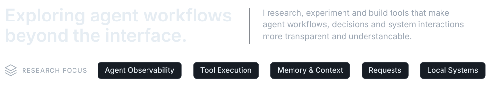

  <picture>
    <source media="(prefers-color-scheme: dark)" srcset="assets/profile-intro-dark.svg">
    <source media="(prefers-color-scheme: light)" srcset="assets/profile-intro-light.svg">
    
  </picture>

  <picture>
    <source media="(prefers-color-scheme: dark)" srcset="assets/profile-projects-dark.svg">
    <source media="(prefers-color-scheme: light)" srcset="assets/profile-projects-light.svg">
    
  </picture>

