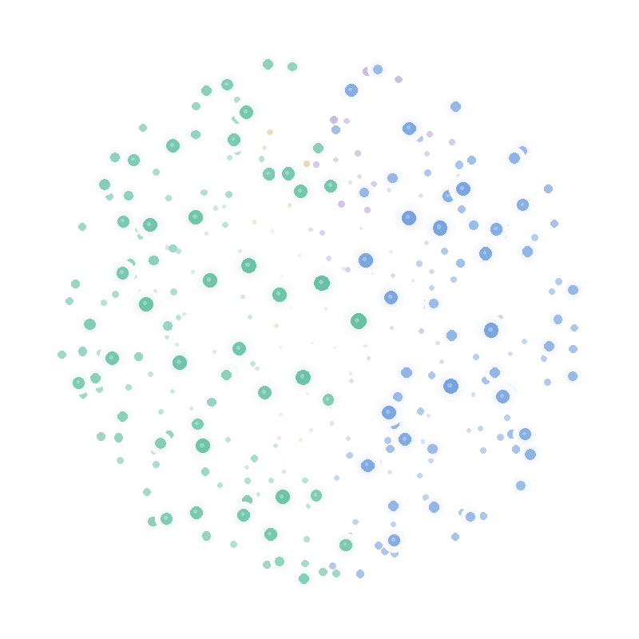
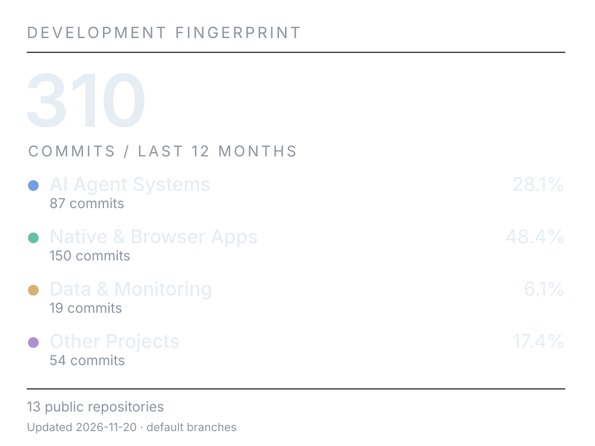
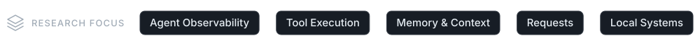

<picture><source media="(prefers-color-scheme: dark)" srcset="assets/fingerprint/legend-dark.svg"><source media="(prefers-color-scheme: light)" srcset="assets/fingerprint/legend-light.svg"></picture>

<picture>
  <source media="(prefers-color-scheme: dark)" srcset="assets/fingerprint/research-focus-dark.svg">
  <source media="(prefers-color-scheme: light)" srcset="assets/fingerprint/research-focus-light.svg">
  
</picture>

  <picture>
    <source media="(prefers-color-scheme: dark)" srcset="assets/profile-projects-dark.svg">
    <source media="(prefers-color-scheme: light)" srcset="assets/profile-projects-light.svg">
    
  </picture>

